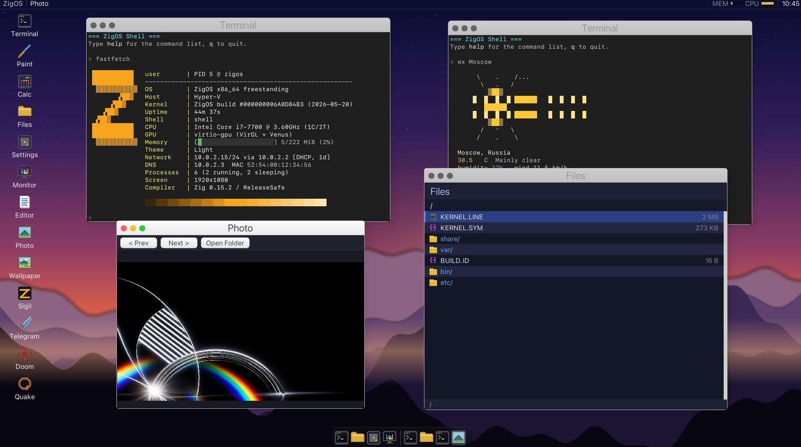

# ZigOS



x86_64 hobby OS in Zig (~208 KLoC) — SMP + hybrid-CFS scheduler, demand
paging with swap, IOMMU isolation, NVMe with async Q_DEPTH=16, in-kernel
eBPF with a verifier and JIT, TLS 1.3 with Mozilla NSS roots, ACPI S3
suspend/resume, a Vulkan compositor via virtio-gpu + Venus, a graphical
installer, 80+ native apps including Doom and Quake 1. A Linux
compatibility layer runs unmodified Linux programs — an Alpine userland
with git, Python and Node.js, Claude Code in a terminal window — and the
Zig compiler, which builds the ZigOS kernel inside ZigOS. Boots on real
hardware.

The screenshot above is a real boot: a shell with `fastfetch`, `wx Moscow`
(HTTPS + JSON over the kernel's TLS stack), the photo viewer (`stb_image`
PNG decode), and the file manager — all userspace ELFs on top of a fresh
kernel.

## Running it

**This is not a `git clone && qemu-system-x86_64 kernel.elf` project.**
The desktop's GL/Vulkan path requires virtio-gpu Venus, which only works
on a specific host stack:

- **QEMU master** with the Venus blob-scanout work (tested against
  `qemu-11.0.50`, built 2026-05-08). Stock QEMU 9.x lacks complete
  blob-scanout — the desktop boots to a black screen and the kernel
  logs report everything OK, because the guest-side path completes
  fine; the host just never produces a scanout.
- **virglrenderer** built with Venus enabled (`-Dvenus=enabled`),
  linked against your host mesa.
- **mesa** on the host providing the Venus driver.
- **Zig 0.15.2** — the build pins this exact version.
- An x86_64 Linux build host. Tested on Ubuntu 22.04 / 24.04.

Without Venus the kernel still boots: it falls back to 2D virtio scanout
or the plain UEFI GOP framebuffer — the GOP path is also how it runs on
real hardware — but the Vulkan apps and the GL compositor stay off.

Once the stack is in place:

```sh
zig build -Doptimize=ReleaseSafe
bash run-uefi-ext2-iommu.sh
```

`run-uefi-ext2-iommu.sh` is the canonical boot script — UEFI + ext2 root
image + IOMMU pass-through + the full driver stack (NVMe×3, xHCI,
virtio-net/gpu/sound, AC97, HDA, e1000, i225). The other `run-*.sh`
scripts either add devices (nvdimm/pmem, USB-attached storage) or
target degraded configurations (no IOMMU, SDL display, TCG-only) for
bisecting host-side regressions.

### Linux programs and the self-build

The Linux userland is not part of the repository; scripts in `tools/`
write it into the root image after a build (`zig build` regenerates the
image):

- `add_busybox_to_image.sh`, `add_musl_to_image.sh` — a static busybox,
  musl's dynamic linker.
- `add_rootfs_to_image.sh` — an Alpine root made with `apk --root`
  (bash, git, python3, openssl, Node.js, ...), together with the checks
  from `linux-tests/`.
- `add_zig_to_image.sh`, `build_static_nasm.sh`, `add_tree_to_image.sh` —
  the official static Zig compiler, nasm and the kernel's own source
  tree; `zig build kernel` then builds the kernel inside ZigOS (the
  image needs room for the build caches: `-Dext2-mb=2048`).

Boot mode 19 runs whichever of these checks the image carries.

## What's in it

- **Kernel (`src/`):** SMP scheduler (hybrid-CFS, three priority bands ×
  min-vruntime within each), x86_64 4-level paging with PCID + global
  pages, demand paging with a page cache and swap, file and shared
  mappings through the page cache, an out-of-memory killer that honours
  `oom_score_adj`, IOMMU isolation per DMA device, NVMe async I/O with
  IRQ-driven CQ reap, ext2 with a write-back buffer cache, MSI-X with
  posted-write flush, sleep-aware mutexes, POSIX signals with job
  control (SIGSTOP/SIGCONT, EINTR, siginfo_t), sessions and ptys, a
  TSC-driven clock, MWAIT idle, MCE bank decode on #MC, PMU sampling on
  PMI.
- **Linux compatibility (`src/cpu/syscall/linux_*.zig`):** unmodified
  Linux x86-64 binaries, static or dynamically linked against musl, run
  next to native apps: fork/execve, threads (clone + futex), mmap /
  mprotect / brk, signals, ptys with job control, `/proc`, TCP, UDP and
  Unix sockets, epoll, eventfd. `linux-tests/` checks it with busybox,
  an Alpine root (apk, bash, git, python3, openssl, ssh-keygen), Node.js
  with npm, and Claude Code.
- **Self-hosting:** the Zig compiler runs under the Linux layer and
  builds the kernel inside ZigOS; the lints the build depends on are
  Zig programs for that reason.
- **Installer (`src/ui/installer.zig`):** graphical installer (boot
  mode 17) over an in-kernel GPT partitioner, mkfs.ext2 and mkfs.fat32;
  it copies the system, installs the bootloader and registers its own
  UEFI boot entry.
- **eBPF (`src/bpf/`):** in-kernel VM with a verifier and x86_64 JIT
  (RFC 9669 ISA), programs loaded from userspace via `sys_bpf`.
- **ACPI (`src/acpi/`):** AML interpreter that walks real firmware
  tables, SCI/EC handling, S3 suspend-to-RAM with a working resume —
  PCI device re-init (GPU, xHCI, NVMe) and AP re-online included; Quake
  survives a suspend cycle.
- **Networking:** TCP/IP, DHCP client, DNS, 127.0.0.0/8 loopback,
  sockets for native and Linux programs, `/proc/net/{info,sock,arp}`,
  TLS 1.3 with 146 Mozilla NSS roots — outbound HTTPS from a userspace
  app works, and the Telegram client speaks MTProto against a real
  account.
- **Desktop and compositor:** window manager with a dock, a launcher
  and window snapping; only the regions that changed are repainted.
  virtio-gpu Venus blob scanout with page flipping, zero-copy window
  framebuffers, 2D and GOP-framebuffer fallbacks for non-GL hosts and
  real hardware. The Vulkan path also runs on a host GPU through Mesa's
  dzn (`tools/host-gpu`).
- **Debug machinery (`src/debug/`):** in-kernel GDB stub and debugger,
  KASAN + KCSAN, lock witness, watchdog, crash autopsy, per-phase perf
  accounting with a host-stall classifier, a profile of where a Linux
  program's time goes. The kernel is deliberately loud about its own
  health.
- **Userspace (`app/`, 80+ apps):** Doom (Chocolate Doom), Quake 1
  (id 1999 WinQuake), Vulkan cube/triangle, a small web browser,
  Telegram client, photo viewer, text editor, file manager, calc,
  paint, weather client (`wx`), fastfetch, netstat, syscall fuzzer.
  GUI apps share an app skeleton with immediate-mode widgets
  (`lib/app.zig`).
- **Bootloader (`uefi/`):** custom UEFI app with GRUB-style cmdline
  editor, multi-mode boot dispatch, NVRAM boot-history ring.

## Layout

```
src/
  cpu/      idt smp arch (gdt msr mce pmu) mmu (pcid tlb iommu)
            syscall: native + linux_{fs,mm,net,proc,signal,thread,time,tty}
  driver/   by class: bus (pci virtio) block (nvme ahci ata) nic (e1000 i225 virtio_net)
            gpu (virtio_gpu gop_fb) sound (ac97 hda virtio_sound) input usb (xhci) console
  proc/     process sched runqueue signals pipe pty tty session hrtimer softirq elf_loader
  mm/       pmm vmm vma heap tlsf slab page_cache swap shm pmem
  fs/       vfs ext2 fat32 tarfs devfs procfs lproc gpt
  net/      tcp ip dhcp dns socket unix
  crypto/   tls x509 asn1 random
  acpi/     aml s3 ec sci
  bpf/      vm verifier jit
  virt/     kvm hyperv vmx
  time/     apic hpet pit rtc smi
  ui/       desktop installer gpu_compositor fonts icons
  debug/    kdbg gdb_stub kasan kcsan witness watchdog perf linux_prof
  util/     typed addresses, lock-guarded data, state graphs, deadlines
  test/     boot-mode selftests and stress tasks
app/        native userspace ELFs
lib/        libc, app skeleton + widgets, http/json/html, venus + virgl wire encoders
linux-tests/ checks of the Linux layer: C tests, busybox, Alpine, Node.js
uefi/       custom UEFI bootloader
tools/      host-side test harnesses, lints, image helpers
quake_src/  vendored Quake 1 source
doom_src/   vendored Chocolate DOOM source
```
